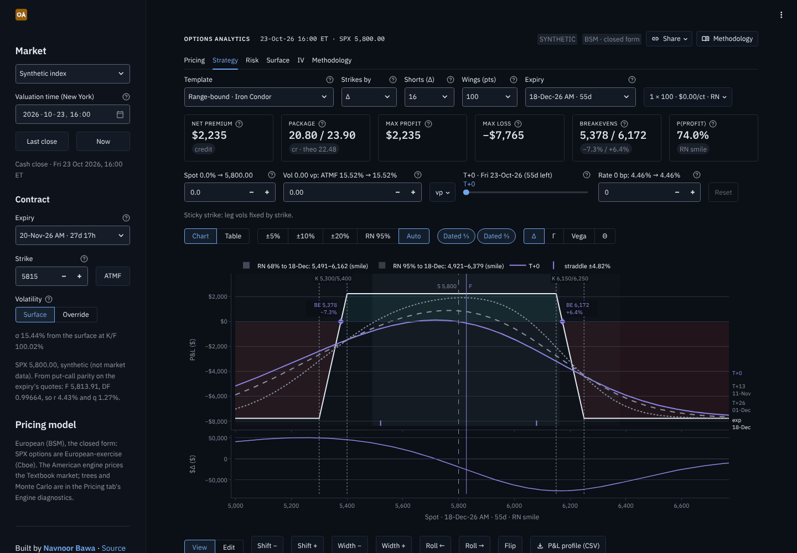
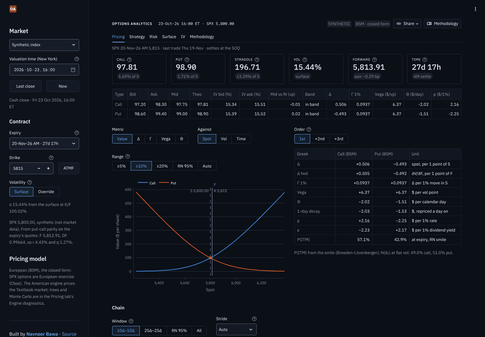
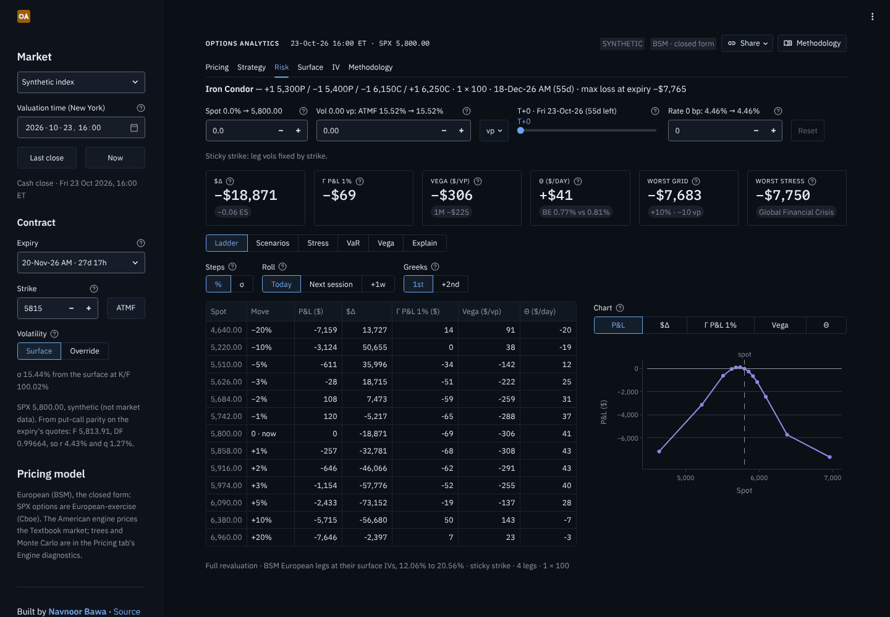
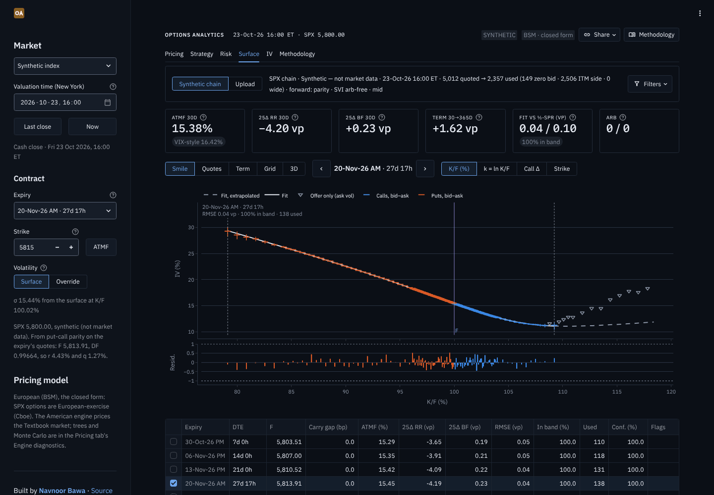
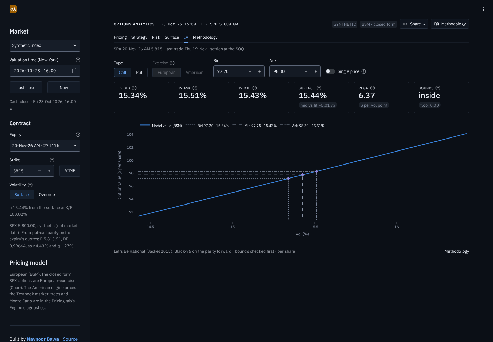

# Options Pricing & Strategy Analyzer

[](https://github.com/NavnoorBawa/Option-Pricing-and-Strategy-Analyzer/actions/workflows/ci.yml)


[](https://option-pricing-and-strategy-analyzer.streamlit.app)

**Live app: <https://option-pricing-and-strategy-analyzer.streamlit.app>**

An options analytics workstation built with Streamlit. It prices European and American options, shows Greeks to
third order, builds and analyses any multi-leg strategy, stress-tests it and measures its Value-at-Risk, and turns
implied-volatility quotes into arbitrage-checked surfaces and local volatility.

The numerical core is a standalone, tested Python package (`options_analyzer`, needing only NumPy, SciPy and pandas).
Its engines are validated against independent libraries (QuantLib, Jäckel's Let's Be Rational, 60-digit mpmath), and
the Streamlit app is a thin interface on top of it.



## Highlights

- **Implied volatility in 19 µs per quote, 15 ms per 10,000**: a vectorised port of Jäckel's *Let's Be Rational*
  (revision 1520), accurate to a few ulps of the problem's own conditioning on the 66,738 quotes with time value among 97,086 cases checked at 60 digits.
- **American options by spectral collocation**: the Andersen–Lake–Offengenden engine prices the 4,495-put grid of
  Healy (2021) with an RMSE of 1.6e-7 against QuantLib's high-precision engine, in under a millisecond per option. A
  2,000-step binomial tree gives an RMSE of 1.5e-4 in 14 ms. In the app it is the "American (ALO)" pricing model, with
  smooth Greeks, the early-exercise boundary and American implied volatility.
- **Desk-style risk**: dollar and second-order position Greeks, a Greek ladder by full revaluation, vega by expiry
  and delta bucket, one-month-weighted vega, and strikes chosen by delta.
- **Market time done properly**: a New York clock with the NYSE calendar, AM and PM settlement, minute-based year
  fractions and event variance, plus a realistic synthetic option chain and adapters for downloaded chains.
- **A desk interface on one synthetic market**: every tab prices from one published, arbitrage-free surface fitted to
  a synthetic SPX chain at a pinned valuation time; listed legs at their own smile vols; a risk console with six
  reports; tabs bound to the URL that compute only when opened; and a Methodology reference that opens beside any
  tab.

The [scorecard](docs/scorecard.md) lists every before-and-after measurement and the free resources the project is
built from.

## Features

**Pricing**
- Black–Scholes–Merton with continuous dividend yield, exact at every edge case (expiry, zero volatility).
- American (ALO): the Andersen–Lake–Offengenden engine with fast, accurate and high schemes, Greeks by finite
  differences of the engine (closed form where the option is European, one-sided where a bump crosses an exercise
  regime, and the app says which), the early-exercise premium and the exercise boundary, and a plain statement
  whenever the engine falls back to a tree.
- Binomial trees: Leisen–Reimer (≈O(1/n²) convergence for European exercise) and Cox–Ross–Rubinstein, European or
  American exercise, with bump-and-reprice tree Greeks, convergence charts and the early-exercise boundary.
- Monte Carlo with exact terminal sampling, antithetic and control variates, reproducible seeds and 95 % confidence
  intervals, withheld with the reason when fewer than 300 paths finish on the scarce side of the strike (there the
  interval covered the true price in only 88 % to 95 % of runs).
- Theta per calendar day beside the one-day decay by full revaluation, which leads when the two differ by more than
  10 %: inside three days to expiry theta / 365 is off by up to 2×, and for a 1-day at-the-money put it shows −10.66 on
  a 21.56 premium that the day takes whole.
- All 14 Greeks (delta … ultima, plus rho and dividend rho) for calls and puts, with explicit units.
- The Pricing tab: six tiles (call, put, straddle, vol, forward with the strike's own pair-implied forward against
  the parity forward, time to settlement), the contract's bid, ask, mid and their implied vols against the fit, a
  value or Greek profile against spot, vol or time, the chain ladder (a row click sets the strike), the Greeks to
  third order with P(ITM) from the smile (Breeden–Litzenberger) beside N(d₂), and engine diagnostics (the trees and
  Monte Carlo against the closed form, computed only while open).

**Strategy**
- 26 templates (verticals, straddles and strangles, iron butterfly and condor, butterflies, ratio backspreads,
  collars, jade lizard, synthetics, calendars and diagonals) or any custom combination of calls, puts and stock.
- Under the synthetic index the legs are listed contracts: an expiry date and settlement, short strikes chosen by
  their own delta on the smile and snapped to listed strikes (16Δ by default), wings in index points, each leg's vol
  read from the fitted surface at its strike and expiry (or typed over it, marked), and its bid and ask from the
  chain. The default is the iron condor a desk would open on (at 23-Oct-26 16:00: 5,300 / 5,400 / 6,150 / 6,250 on
  18-Dec-26).
- Six tiles: net premium, the package's natural market against its theoretical value, max profit and loss,
  breakevens and the probability of profit on the risk-neutral smile (log-normal at the flat vol in the Textbook
  market), each with its basis.
- One P&L chart with expiry, today and dated curves, the risk-neutral 68 % and 95 % ranges to the front expiry from
  the surface's distribution, and a Greek strip; a date × spot table view; a what-if strip shared with Risk (spot,
  vol in points, relative or one-month scaled, trading-session date and rate) that marks the screen as a scenario
  while any shift is on.
- A blotter that edits every leg (side, size, strike, expiry, vol and fill), structure steppers (shift, width, roll,
  flip), and edits that survive tab switches. Contract multiplier and commissions are included.

**Risk** (for the position built on the Strategy tab, or the template named in the link)
- A position line and six pinned tiles: dollar delta (and its E-mini equivalent), the gamma P&L of a 1 % move, vega
  per vol point beside the one-month-weighted vega, theta per day with the breakeven daily move against the implied
  move, and the worst loss on the scenario grid and in the stress tests.
- Six reports, each computed only when chosen: a Greek ladder by full revaluation; scenario grids of spot × vol and
  spot × trading date, and an illustrative FINRA 4210(g)-style portfolio-margin array (ten points from −8 % to
  +6 % for a broad-based index); stress tests; VaR; vega by expiry and delta bucket; and an explain of the what-if
  move (a second-order Greek waterfall and the exact Shapley split over spot, vol, time and rate).
- Stress tests calibrated to Black Monday, the dot-com bust, 2008, Volmageddon, the COVID crash, the 2022 rate shock,
  the April 2025 tariff shock and the Fed's 2026 severely adverse scenario, plus custom shocks. Each vol shock is the
  ratio of the sourced closing levels (FRED VIXCLS and VXOCLS; the Fed's 72.0 / 26.4), checked by a test against a
  table of sources.
- Monte Carlo VaR and Expected Shortfall with Normal, Student-t or GARCH(1,1) returns and implied-vol dynamics on by
  default (index-like: vol of vol 100 %, spot–vol correlation −0.7), shown beside the spot-only VaR and ES with implied
  vol frozen, which understates a 45-day short straddle's 99 % VaR by 27 % ($2,833 against $3,862), and delta-normal
  VaR and the exact delta-gamma-theta VaR (the non-central chi-square quantile) for comparison. The VaR model's
  backtest is quoted on a synthetic GARCH-t history and tagged as such.
- In the library: VaR and ES backtests (Kupiec, Christoffersen, the Basel traffic light, Acerbi–Szekely Z2, FZ0 and
  Diebold–Mariano, MAR32's P&L attribution test, each with its power at the sample size), and P&L explain by a
  second-order Greek waterfall and by the exact Shapley split.

**Surface and IV**
- The Surface tab: a data panel whose counts reconcile (quoted, used, and each exclusion by reason), filters and
  calibration settings (a changed setting is marked in the header), six tiles (30-day ATMF vol beside a VIX-style
  model-free figure, 25Δ risk reversal and butterfly, term slope, fit error against the half-spread, arbitrage
  counts), smile, quotes, term, grid and 3D views, an expiry table that sets the focus expiry, and CSV and Excel
  exports that carry their provenance (source, valuation time, model, fit and version).
- Surfaces from quotes as a desk builds them: each expiry's forward and discount factor from put–call parity (a
  weighted fit of C − P = DF·(F − K) near the money, outliers trimmed), prices inverted with Black-76 at them, and an
  SVI smile per expiry fitted to the bid/ask with spread weights and held free of butterfly and calendar arbitrage,
  its wings within Lee's moment bound; then local volatility with Gatheral's formula, its time derivative taken from
  how each smile scales with its at-the-money variance (0.1 vol point from the truth on noise-free quotes at listed
  monthly expiries, where secants between expiries were 2 points off) and its truncation error reported. On the synthetic SPX chain the
  forwards come back within 0.22 bp and the at-the-money vols within 0.0064 vol point, every fitted vol inside its
  bid/ask. Arbitrage in the quotes themselves is reported, and an expiry that cannot be fitted without it says so.
- Parametric SSVI surfaces as a worked example.
- An implied-volatility solver for European and American quotes that checks the no-arbitrage bounds first and
  rejects a quote whose time value is lost in rounding (within 1e-12·max(S, K) of its zero-volatility value) as
  `no_time_value` rather than return a vol made of rounding error; under the American (ALO) model it inverts the
  engine's price.

**Desk shell**
- The app opens on a synthetic SPX index at a valuation time (by default the last completed cash close, so every
  visitor sees the same numbers all day): the chain is priced by the app's generator, labelled synthetic everywhere,
  and read back like real quotes, with parity forwards and the arbitrage-free SVI surface that every tab prices
  from. The sidebar picks a listed expiry (AM or PM settlement, time to it in minutes) and a strike on the listed
  5-point grid; the vol is the surface's at that strike (or a typed override, marked), and the rate and dividend
  yield are those implied by the expiry's forward and discount factor, so every tab prices Black-76 on them. A
  Textbook market keeps the typed inputs of version 2 (S = K = 100, one year), and links from version 2 open it.
- A one-row header with the valuation time and the index level, state badges (synthetic data, a vol override, a
  changed fit), the engine in use and a Share link that reproduces the exact view: the market and its valuation
  time, the open tab, the sidebar inputs, the strategy and its what-if shifts, and each tab's view.
- One number standard everywhere (U+2212 minus, no negative zero, one precision per column, units in every header),
  enforced by a lint in the tests; amber marks user state only (an override, a changed fit, a what-if scenario);
  and layouts checked in Chromium at 1,440 px and on 360 to 440 px phones.
- Only the open tab computes, so switching tabs and changing inputs stays fast. Old links keep working.
- The Methodology tab documents every model, formula and assumption with verified references, and opens as a drawer
  beside whichever tab is open.

| Pricing | Risk |
| --- | --- |
|  |  |
| **Surface** | **IV** |
|  |  |

## Quick start

Requires Python 3.10 or newer.

```bash
git clone https://github.com/NavnoorBawa/Option-Pricing-and-Strategy-Analyzer.git
cd Option-Pricing-and-Strategy-Analyzer
pip install -r requirements.txt
streamlit run main.py
```

The app opens at <http://localhost:8501>. A dev container (VS Code / GitHub Codespaces) is included and starts the
app automatically. To install it as a package instead, `pip install ".[app]"` and run `options-analyzer`;
`pip install .` installs only the numerical core.

## Using the library

```python
import numpy as np
from options_analyzer import american, black_scholes as bs, implied_vol, scenarios, strategies as st

bs.price(100, 105, 0.5, 0.04, 0.22, q=0.01, option_type="put")  # 8.1319
american.price(100, 105, 0.5, 0.04, 0.22, 0.01, option_type="put")  # 8.3696 (Andersen-Lake-Offengenden)
american.greeks(100, 105, 0.5, 0.04, 0.22, 0.01, option_type="put")["delta"]  # -0.5768, smooth American Greeks
implied_vol.implied_volatility(8.50, 100, 105, 0.5, 0.04, 0.01, "put")  # 0.2332

strikes = np.array([90, 95, 100, 105, 110.0])
calls = bs.price(100, strikes, 0.5, 0.04, 0.22, q=0.01, option_type="call")
implied_vol.implied_volatility_batch(calls, 100, strikes, 0.5, 0.04, 0.01, "call")  # 0.22 for every strike

market = st.Market(spot=100, rate=0.04, volatility=0.22, expiry=0.5, dividend_yield=0.01)
condor = st.build_template("Iron Condor", strike=100, width=5)
st.analyze(condor, market).breakevens  # [91.909, 108.091]
st.position_risk(condor, market).dollar_delta  # -0.411, delta times spot
scenarios.greek_ladder(condor, market)  # P&L and Greeks at spot -20 % … +20 %, by full revaluation
st.strike_for_delta(-0.16, market, 0.5, 0.22, "put")  # 88.07, the 16-delta put strike
```

`options_analyzer.clock` holds the market clock, and `options_analyzer.market_data` holds the synthetic chain
(`sample_chain`) and the chain adapters (`read_chain`).

## Validation

- **Independent oracles** (`pytest -m oracle`): American prices against QuantLib's QdFp and finite-difference
  engines, and implied volatilities against Jäckel's own reference implementation. CI installs the oracle libraries
  and fails if any oracle test is skipped.
- **High-precision references**: Greeks against 40-digit mpmath derivatives, 100,000 implied-volatility cases priced at
  60 digits (the accuracy bound is proven on the 66,738 quotes that keep time value; the rest round to intrinsic), and the 4,495-put American grid of Healy (2021) generated with QuantLib and stored in the repository, so
  the main suite needs no QuantLib. On 20,000 random double-precision quotes, every quote with time value above
  1e-12·max(S, K) inverts to within 1e-5 of the vol that priced it (worst 7.7e-6); the other 2,259 are rejected.
- **Coverage studies**: the Monte Carlo 95 % interval's coverage is checked with binomial tests at 10 to 1,000 paths on
  the scarce side of the strike, and the reliability flag is set where coverage falls short.
- **Invariants**: put–call parity and symmetry, no-arbitrage bounds, monotonicity, Greeks against finite
  differences, the Greek-ladder identities across all 26 strategy templates, and the vega-bucket sums.
- **App tests**: Streamlit AppTests of every tab and deep link, plus Chromium browser tests of the layout, run locally
  with `pytest -m e2e`.
- The app's Methodology tab documents every model with its references, and
  [`docs/methods/american_alo.md`](docs/methods/american_alo.md) states the American engine's error and limits.

## Conventions

- Time to expiry runs to the expiry's settlement in minutes / 525,600 under the synthetic index (AM monthlies at the
  opening print, PM weeklies at the 16:00 close), and is calendar days / 365 in the Textbook market. Rates and
  dividend yield are continuously compounded.
- Greeks are displayed per calendar day (theta, charm, veta, color), per volatility point (vega, vanna, zomma …), per
  1 % rate move (rho) and per $1 spot move (delta, gamma, speed).
- VaR horizons are in trading days (252 per year).
- Strategy quantities are signed (+ long, − short); one unit is an option on one share. P&L is shown for the whole
  position (contracts × multiplier).

## Project structure

```
main.py                     Streamlit entry point (also Streamlit Community Cloud's)
options_analyzer/
  black_scholes.py          BSM prices and analytical Greeks
  binomial.py               CRR / Leisen-Reimer trees, American exercise
  american.py               Andersen-Lake-Offengenden American engine
  monte_carlo.py            Variance-reduced Monte Carlo
  lets_be_rational.py       Jäckel's Let's Be Rational, vectorised
  implied_vol.py            Bounds-checked implied volatility, scalar and batch
  strategies.py             Leg-based strategy engine, templates, position risk
  scenarios.py              Stress tests, scenario grids, Greek ladder, vega buckets
  risk.py                   Monte Carlo VaR / Expected Shortfall
  vol_surface/              SVI, SSVI, quote parsing, surface fitting, local volatility
  clock.py                  Market clock: NYSE calendar, settlement times, variance clock
  market_data/              Synthetic option chain, chain adapters, schema and OCC symbols
  ui/                       Streamlit interface (one module per tab, desk header, Methodology)
tests/                      pytest suite (engines, oracles, invariants, app); tests/oracle needs QuantLib
benchmarks/                 Timing scripts for the engines
docs/                       Scorecard, method notes, data policy, screenshots
```

## Development

```bash
pip install -r requirements-dev.txt     # app dependencies plus pinned test and lint tools
pytest -n auto --dist loadfile           # 5,000 tests in parallel
pip install -r requirements-oracle.txt && pytest -m oracle   # the QuantLib, Let's Be Rational and mpmath oracles
ruff check . && ruff format --check .
```

Continuous integration runs the linters, the suite on Python 3.10–3.14, the oracle tests, the suite against the
oldest supported dependency versions, and a wheel build. See [CONTRIBUTING.md](CONTRIBUTING.md).

## Data

The public app uses synthetic data and files you upload; it never scrapes market data. The
[data policy](docs/data_policy.md) lists each source's terms, and the tests enforce it.

## Limitations

- Strategy and Risk value every leg with Black–Scholes–Merton at its own surface vol and expiry, sticky strike: the
  smile does not move with spot in scenarios, and exercise is European (the textbook market's American engine prices
  the Pricing and IV tabs only, and the Strategy tab says what early exercise adds). Legs on a later expiry than the
  front one still take the front expiry's carry (on the default call calendar about 2 bp off its own discount rate,
  $2.69 a contract).
- The portfolio-margin array is illustrative (FINRA 4210(g)-style), not a broker's requirement. Transaction costs
  beyond a flat commission and discrete dividends are not modelled.
- The VaR model's backtest runs on a synthetic history: there is no market history in the public app.

[ROADMAP.md](ROADMAP.md) lists what is done and what remains, and
[docs/improvement-guide.md](docs/improvement-guide.md) says how to take it further. This project is for education and
analysis only and is **not investment advice**. Version 2.0 was a ground-up rebuild after a full audit of the original
app ([docs/reviews/audit-v1.md](docs/reviews/audit-v1.md)); version 3.0 is summarised in the
[scorecard](docs/scorecard.md).

## Author

Created by [Navnoor Bawa](https://www.linkedin.com/in/navnoorbawa/). Released under the [MIT License](LICENSE).
