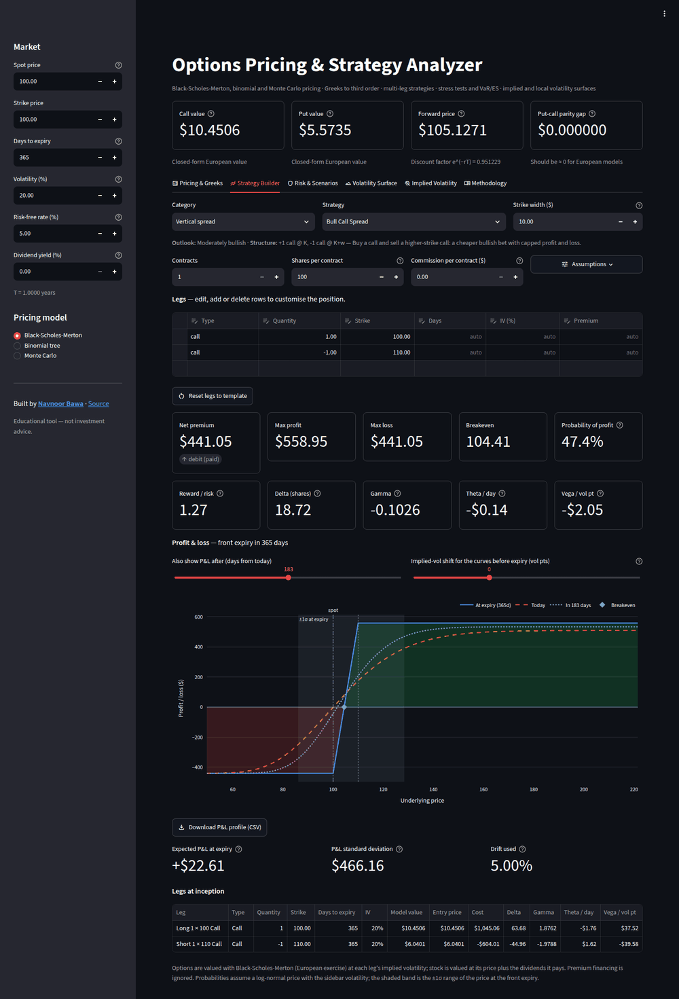
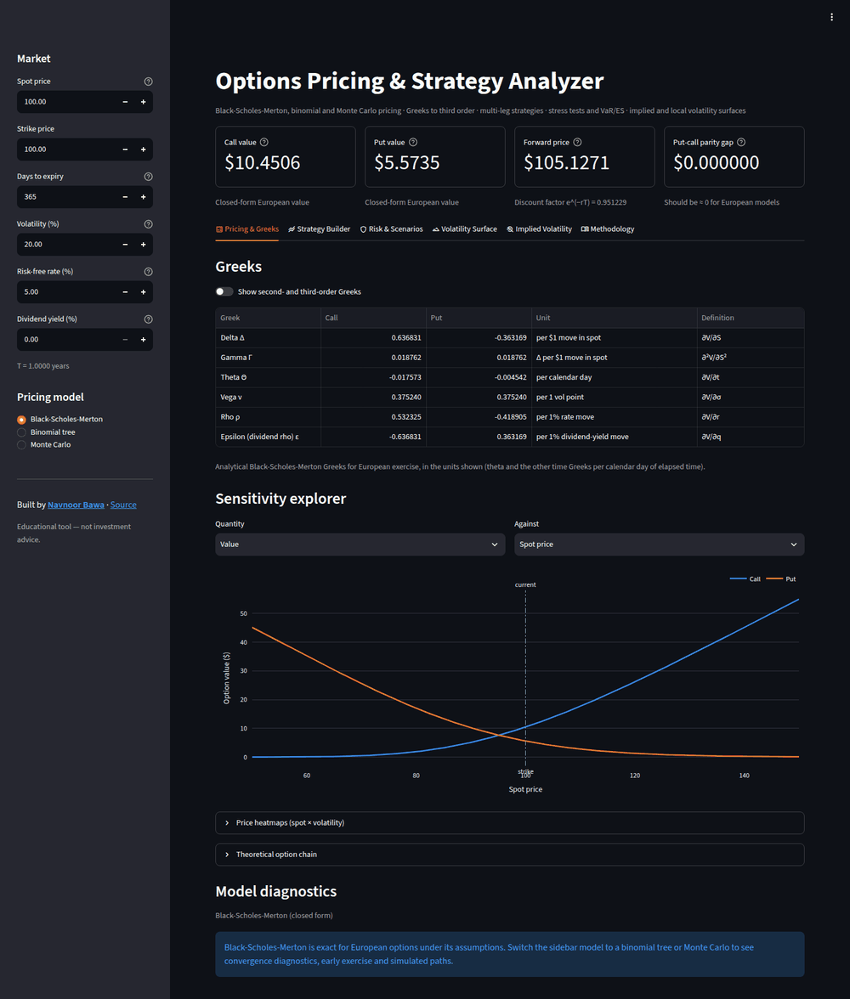
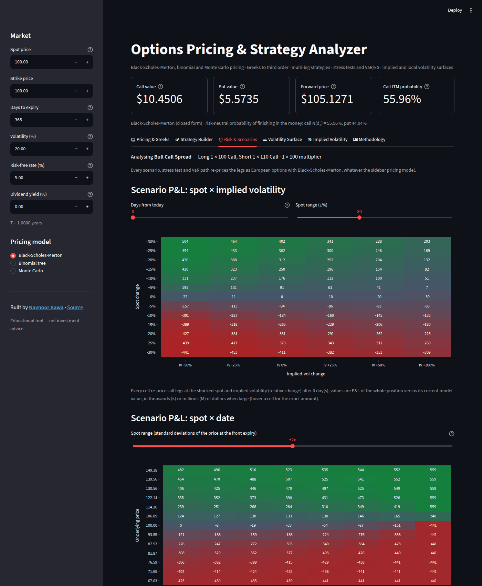
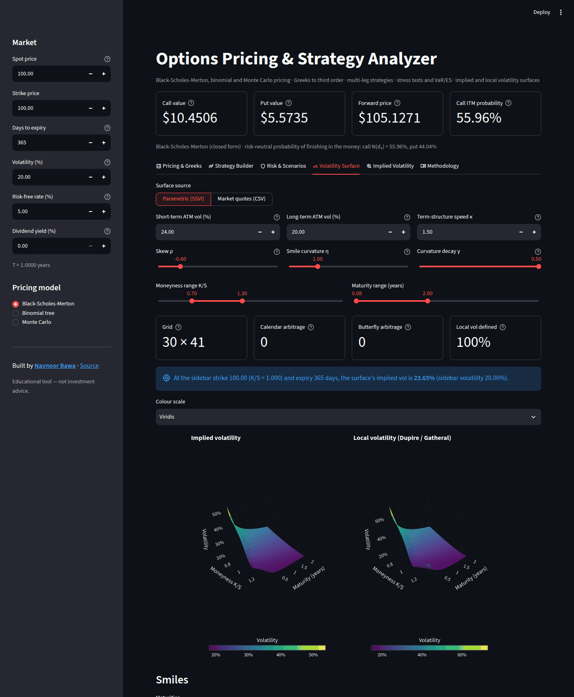
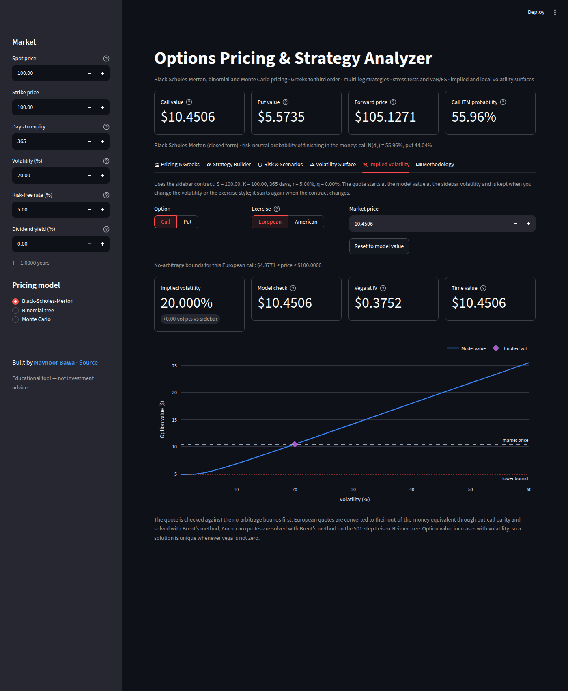

# Options Pricing & Strategy Analyzer

[](https://github.com/NavnoorBawa/Option-Pricing-and-Strategy-Analyzer/actions/workflows/ci.yml)


An interactive options analytics workbench built with Streamlit: price European and American options with three
models, inspect Greeks to third order, build and analyse any multi-leg strategy, stress-test it against historical
crises, measure its Value-at-Risk, and turn implied-volatility surfaces into arbitrage-checked local volatility.

The numerical core is a standalone, fully tested Python package (`options_analyzer`, needing only NumPy, SciPy and
pandas); the Streamlit app is a thin interface on top of it.



## Features

**Pricing & Greeks**
- Black–Scholes–Merton with continuous dividend yield, exact at every edge case (expiry, zero volatility).
- Binomial trees: Cox–Ross–Rubinstein and Leisen–Reimer (≈O(1/n²) convergence for European exercise), European
  or American exercise, tree Greeks and the early-exercise boundary. A 2,000-step American tree prices in about
  25 ms.
- Monte Carlo with exact terminal sampling, antithetic and control variates, reproducible seeds and 95 % confidence
  intervals.
- All 14 Greeks (delta … ultima, plus rho and dividend rho) for calls and puts, with explicit units, a sensitivity
  explorer and spot × volatility price heatmaps.

**Strategy Builder**
- 26 templates — verticals, straddles/strangles, iron butterfly/condor, butterflies, ratio backspreads, collars,
  jade lizard, synthetics, calendars and diagonals — or any custom combination of calls, puts and stock.
- Every leg is editable: side and size, strike, its own expiry and implied volatility, and your actual fill price.
  Your edits are kept per template when sidebar inputs change. Contract multiplier and commissions are included.
- Strike spacing is a percentage of the strike, rounded to the cent; by default it is about half the expected
  move σ√T, rounded to a listed-style strike step, so short-dated templates are realistic trades.
- P&L at expiry, today and at any intermediate date, with an implied-volatility shift, exact breakevens,
  unlimited-risk detection, probability of profit, expected P&L and position/per-leg Greeks.
- Legs are valued as European options with Black–Scholes–Merton; with an American tree in the sidebar, a leg
  that is the sidebar contract shows its American value next to the European value used.

**Risk & Scenarios** (for the position you built)
- P&L heatmaps of spot × implied vol (over a ± % spot range) and spot × date, and time-decay curves, all from
  full re-pricing; the spot × date grid and the time-decay curves step the spot in units of the expected move
  σ√T. Position Greeks across spot use the analytical Black–Scholes–Merton Greeks.
- Stress tests calibrated to Black Monday, the dot-com bust, the 2008 crisis, Volmageddon, the COVID crash, the
  2022 rate shock, the April 2025 tariff shock and the Fed's 2026 severely adverse scenario, plus custom shocks.
- Monte Carlo VaR and Expected Shortfall with Normal, Student-t or GARCH(1,1) returns and optional implied-vol
  dynamics, compared with delta-normal VaR.

**Volatility Surface & Implied Volatility**
- Arbitrage-free SSVI surfaces or your own quotes (CSV), smoothed and turned into local volatility with Gatheral's
  formula; calendar and butterfly arbitrage are detected and reported, never silently patched.
- Implied-volatility solver for European (Black–Scholes–Merton) and American (binomial) quotes that checks
  the no-arbitrage bounds and always converges.
- Settings are stored in the URL, so any setup can be bookmarked or shared.

| Pricing & Greeks | Risk & Scenarios |
| --- | --- |
|  |  |
| **Volatility Surface** | **Implied Volatility** |
|  |  |

## Quick start

Requires Python 3.10 or newer.

```bash
git clone https://github.com/NavnoorBawa/Option-Pricing-and-Strategy-Analyzer.git
cd Option-Pricing-and-Strategy-Analyzer
pip install -r requirements.txt
streamlit run main.py
```

The app opens at <http://localhost:8501>. A dev container (VS Code / GitHub Codespaces) is included and starts the
app automatically.

To use it as an installed package instead: `pip install ".[app]"` installs the app and its `options-analyzer`
command; `pip install .` installs only the numerical core.

## Using the library

```python
from options_analyzer import black_scholes as bs, binomial, implied_vol, strategies as st

bs.price(100, 105, 0.5, 0.04, 0.22, q=0.01, option_type="put")  # 8.1319
bs.greeks(100, 105, 0.5, 0.04, 0.22, q=0.01, option_type="put")["vega"]  # 27.797 (per 1.00 of vol)
binomial.price(100, 105, 0.5, 0.04, 0.22, 0.01, "put", 1001, american=True, method="lr")  # 8.3695
implied_vol.implied_volatility(8.50, 100, 105, 0.5, 0.04, 0.01, "put")  # 0.2332

market = st.Market(spot=100, rate=0.04, volatility=0.22, expiry=0.5, dividend_yield=0.01)
condor = st.build_template("Iron Condor", strike=100, width=5)
metrics = st.analyze(condor, market)
metrics.breakevens  # [91.909, 108.091]
metrics.max_loss  # 1.909 per share
metrics.probability_of_profit  # 0.398
```

## Conventions

- Time to expiry is calendar days / 365; rates and dividend yield are continuously compounded.
- Greeks are displayed per calendar day (theta, charm, veta, color), per volatility point (vega, vanna, zomma …),
  per 1 % rate move (rho) and per $1 spot move (delta, gamma, speed). Time Greeks measure the passage of time, so
  theta is usually negative for a long option.
- VaR horizons are in trading days (252 per year).
- Strategy quantities are signed (+ long, − short); one unit is an option on one share. P&L is shown for the whole
  position (contracts × multiplier).

The **Methodology** tab in the app documents every model, formula and assumption with references.

## Project structure

```
main.py                     Streamlit entry point
options_analyzer/
  black_scholes.py          BSM prices and analytical Greeks
  binomial.py               CRR / Leisen-Reimer trees, American exercise
  monte_carlo.py            Variance-reduced Monte Carlo
  implied_vol.py            Bounds-checked implied-volatility solver
  strategies.py             Leg-based strategy engine and templates
  scenarios.py              Stress tests and scenario grids
  risk.py                   Monte Carlo VaR / Expected Shortfall
  vol_surface.py            SSVI, quote fitting, Gatheral local volatility
  ui/                       Streamlit interface (one module per tab, Plotly charts)
tests/                      pytest suite (math, invariants, reference values, UI)
```

## Development

```bash
pip install -r requirements-dev.txt   # app dependencies plus pinned pytest, mpmath and ruff
pytest              # 1,290+ tests: Greeks vs 40-digit derivatives, converged reference values, invariants, UI
ruff check . && ruff format --check .
streamlit run main.py --client.showErrorDetails full   # full tracebacks while debugging
```

Continuous integration runs the linters, the test-suite on Python 3.10–3.14, the test-suite against the oldest
supported dependency versions, and a wheel build for every pull request. See [CONTRIBUTING.md](CONTRIBUTING.md).

Version 2.0 is a ground-up rebuild following a full audit of the original single-file app; [AUDIT.md](AUDIT.md) lists
every issue that was found and how it was resolved.

## Limitations

Strategy valuation uses Black–Scholes–Merton at each leg's implied volatility (no smile dynamics, European exercise),
probabilities are log-normal, and transaction costs beyond a flat commission, margin and discrete dividends are not
modelled. This project is for education and analysis only and is **not investment advice**.

## Author

Created by [Navnoor Bawa](https://www.linkedin.com/in/navnoorbawa/). Released under the [MIT License](LICENSE).
